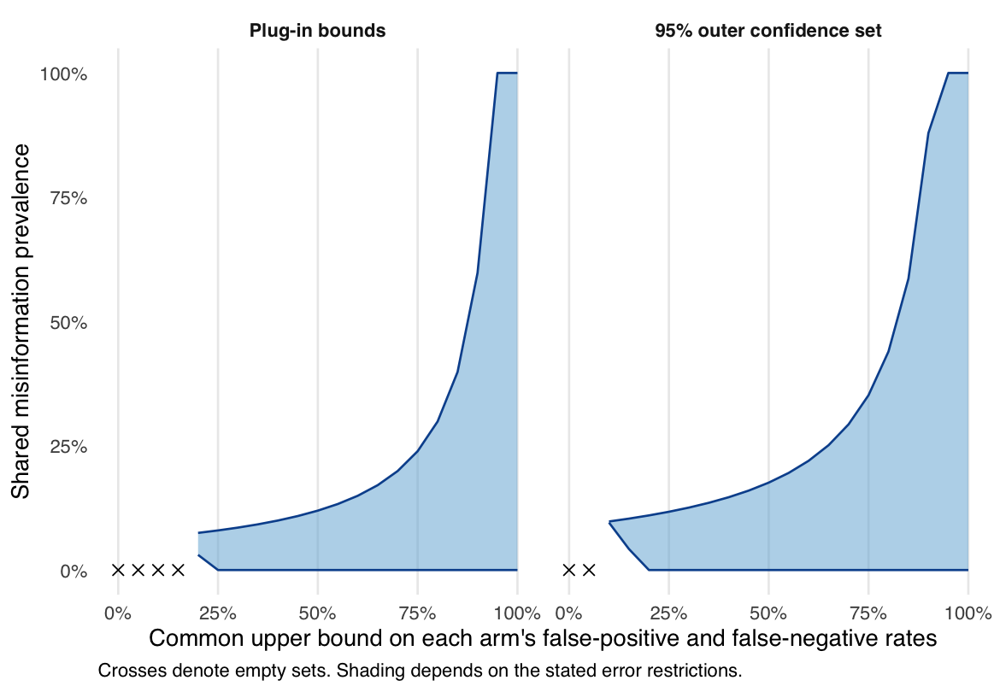

# The Waters of Casablanca: On Political Misinformation

Robert C. Luskin and Gaurav Sood

[Paper](ms/main.pdf) · [Data](data/README.md) · [Illustration design](docs/identification_design.md)

## Question and contribution

What can survey responses tell us about beliefs held before the question?
An incorrect answer can reflect stored misinformation, tentative belief, a guess,
or fresh inference. A person holding a confident false belief can also withhold it.
Randomizing formats reveals changes in answers, but does not by itself distinguish
these response processes.

The manuscript defines five belief states, states conditions for identifying all
five or only misinformation, and derives sharp prevalence bounds under explicit
limits on false positives and false negatives. It separates population prevalence
from individual classification. Confidence ratings provide observations; their
endpoints are not automatically validated measures of stored belief.

## Empirical illustration

One March 2017 ACA proposition illustrates the identification problem. Selecting
the false single-payer option and endorsing it at the scale endpoint are different
observable events. The same arm-specific response rates can arise under very
different misinformation prevalence and reporting errors. Generated tables and a
sensitivity figure show what follows from alternative error restrictions, with
sampling uncertainty reported separately.



The caps are sensitivity assumptions, not estimated error rates. The convenience
sample does not identify national prevalence. The data overlap with the companion
[Hidden Knowledge](https://github.com/finite-sample/know_hidden) project; the
illustration contributes an identification analysis rather than another claim
about format effects.

## Reproduce

```
make restore
make check
```

`make restore` installs the versions in `renv.lock`. `make check` runs all analyses,
builds the manuscript, lints the R code, and runs the tests. `make analysis` runs
stages 01–09 without compiling. The manuscript needs XeLaTeX and latexmk.
`make ci-docker` runs the same checks in `rocker/verse:4.6.0`.

Every empirical number, table, and figure in the manuscript comes from stage 09,
including `tabs/identification_macros.tex`. Analytical counterexamples are
explicitly labeled and tested separately.

## Files and pipeline

| Path | Contents |
|---|---|
| `data/raw/` | Four anonymized survey files; see [data documentation](data/README.md) |
| `data/historical/` | Minimal, hash-verified historical extracts |
| `docs/propositions.csv` | Statement wording, truth keys, exclusions, and key sources |
| `docs/mc_options.csv` | Multiple-choice response coding |
| `docs/recode_ledger.csv` | Departures from earlier coding |
| `docs/citations.csv` | Citation verification ledger |
| `docs/identification_design.md` | Estimand, assumptions, retrospective illustration choices, inference, and validation |
| `docs/exploratory_analyses.md` | Inventory and limits of retained descriptive and historical analyses |
| `R/identification.R` | Binary sharp bounds, finite-state linear program, response intervals, and illustration |
| `R/` | Reusable data, scoring, estimation, and output functions |
| `ms/` | Manuscript source, bibliography, and compiled PDF |
| `tests/testthat/` | Numerical, scoring, data-integrity, reconstruction, and identification tests |

| Script | Purpose |
|---|---|
| `00_config.R` | Paths, source checksums, labels, plot and table styles |
| `01_prepare_data.R` | Verify, read, and score survey sources |
| `02_estimate.R` | Descriptive estimates |
| `03_figures.R` | Descriptive figures |
| `04_tables.R` | Descriptive tables and macros |
| `05_extensions.R` | Scoring sensitivity and descriptive engagement associations |
| `06_correlates.R` | Demographics, ideology, party attachment, and 2010 voting intention |
| `07_historical.R` | Historical response models, partisan gaps, and exploratory response classes |
| `08_reconstruction_tables.R` | Reconstruction tables and macros |
| `09_identification.R` | Current manuscript's identification illustration and sensitivity analysis |
| `99_run_all.R` | Load configuration and helpers; run stages 01–09 |

Prepared data in `data/derived/` are generated and ignored. Historical extracts
make the normal build independent of local archives and sibling repositories;
`scripts/import_archived_data.R` can recreate them from the documented originals.

The earlier [belief-state scoring results](docs/belief_extension_results.md) and
[historical reconstruction](docs/reconstructed_results.md) remain reproducible.
Their scoring labels and latent response classes do not identify the five
premeasurement cognitive states. They are separate reports, not empirical
validation of the current manuscript's state definitions.

<!-- adjacent:start -->

## 🔗 Adjacent Repositories

- [finite-sample/know_hidden](https://github.com/finite-sample/know_hidden) — Mis-measuring Political Knowledge? Do People Know More—or Even Less—about Politics than Commonly Thought?
- [finite-sample/know_misinfo_misinfo](https://github.com/finite-sample/know_misinfo_misinfo) — Misinformation about Misinformation? Of Headlines and Survey Design \(Luskin, Sood, Park, Blank\)
- [finite-sample/know_pgap_review](https://github.com/finite-sample/know_pgap_review) — Replication Materials For "A Gap in Our Understanding? Reconsidering the Evidence for Partisan Knowledge Gaps"
- [finite-sample/know_pgap_cues](https://github.com/finite-sample/know_pgap_cues) — Partisan cues and evaluations of the same economic information \(Roush and Sood\)
- [finite-sample/know_gains](https://github.com/finite-sample/know_gains) — Measuring Learning in Informative Processes \(Luskin, Helfer, Sood\)

_Powered by [Adjacent](https://github.com/gojiplus/adjacent)_

<!-- adjacent:end -->
